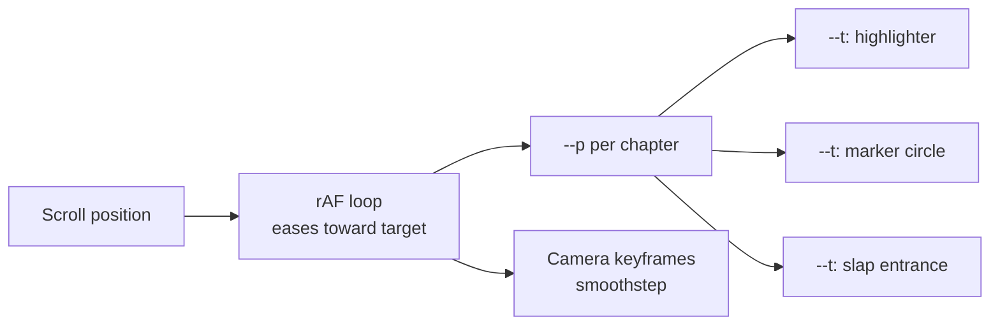
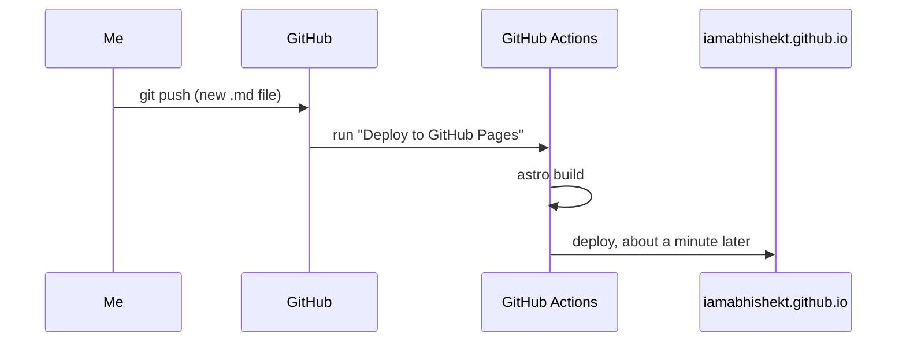

My portfolio is a scroll-driven page that looks like a Vox explainer: scanned paper, a yellow highlighter swiping across a line, a red marker circling a number, a halftone cut-out of me taped down. The idea and the page system come from [Avi Vashishta's write-up](https://www.avivashishta.com/blog/prompt-vox-style-explainer-page-codex-paper-assets). The difference is the assets: he generated them with an image model. I drew every one of them in code.

## One number per chapter

Each chapter is a tall section with a pinned, full-screen stage inside it. One `requestAnimationFrame` loop measures every section and writes a single CSS variable, `--p`, that runs from 0 when the stage pins to 1 when it lets go. It eases toward the scroll position instead of jumping, so motion glides at any scroll speed:

```js
const follow = 1 - Math.exp(-dt * 9)
beat.p += (target - beat.p) * follow
```

Everything else is CSS. Any element gets a window, `--a` to `--b`, and one class turns the chapter's `--p` into its own private progress:

```css
.k {
  --t: clamp(0, (var(--p, 0) - var(--a, 0)) / (var(--b, 1) - var(--a, 0)), 1);
}
```

The highlighter reads `--t` to swipe left to right, the marker circle reads it to draw itself, and the camera reads keyframes for the same `--p`. Scroll back up and it all rewinds, because it is a function of scroll, not a timeline.



## Drawing the assets instead of generating them

The original pipeline asks an image model for each asset. I didn't have one available, so each asset became a short Python function with Pillow, NumPy and SciPy:

| Asset | How it is drawn |
| --- | --- |
| Paper | Periodic noise (`gaussian_filter` with `mode='wrap'`) plus faint fibres, so the tile has no seams |
| Highlighter | A polygon with an angled chisel end, streaks from noise stretched along the stroke |
| Marker circle | Overlapping discs stamped along a loose spiral that overshoots its start |
| Torn strip | Edges from coarse plus fine noise, with fibres poking out |
| Tape | Semi-transparent polygon with torn ends, crepe texture and a few wrinkles |
| Cut-out | My photo, background removed, re-screened as 45-degree halftone dots with a hand-cut border |
| Map | Real country borders from Natural Earth, halftone dots on the ocean only |

The ink assets are black on transparent, so the page uses them as CSS masks and picks the colour itself. One torn strip becomes every chapter card edge and every coloured door at the end.

## The bug that only showed up when rotated

The marker circle was two masks intersected: the scanned ellipse and a conic sweep that opens as `--t` goes to 1. In isolation it rendered perfectly. On the page, a faint red box appeared around the number.

The difference was the camera. The document sits inside a wrapper that zooms and rotates, and ==Chrome leaked a hairline of the red fill at the layer edge when it composited two intersected masks under a rotation==. The fix was to stop asking for the intersection: I pre-coloured the ellipse red and kept a single conic mask.

```css
.ring::after {
  background: url('/vox/circle-red.webp') center / 100% 100% no-repeat;
  mask: conic-gradient(from 290deg, #000 calc(var(--t) * 360deg), transparent 0);
}
```

I only found it because I screenshot every chapter at several scroll positions and zoomed in. A test that only checks "does it render" would have passed.

## How this devlog publishes

The site is Astro on GitHub Pages. Posts are Markdown files in the repo, so publishing is a push:



---

What I'd keep from this even without the paper look: one number per section from JavaScript, everything else in CSS. It is scrubbable, reversible and cheap, and the choreography is a list of windows you can read at a glance.
